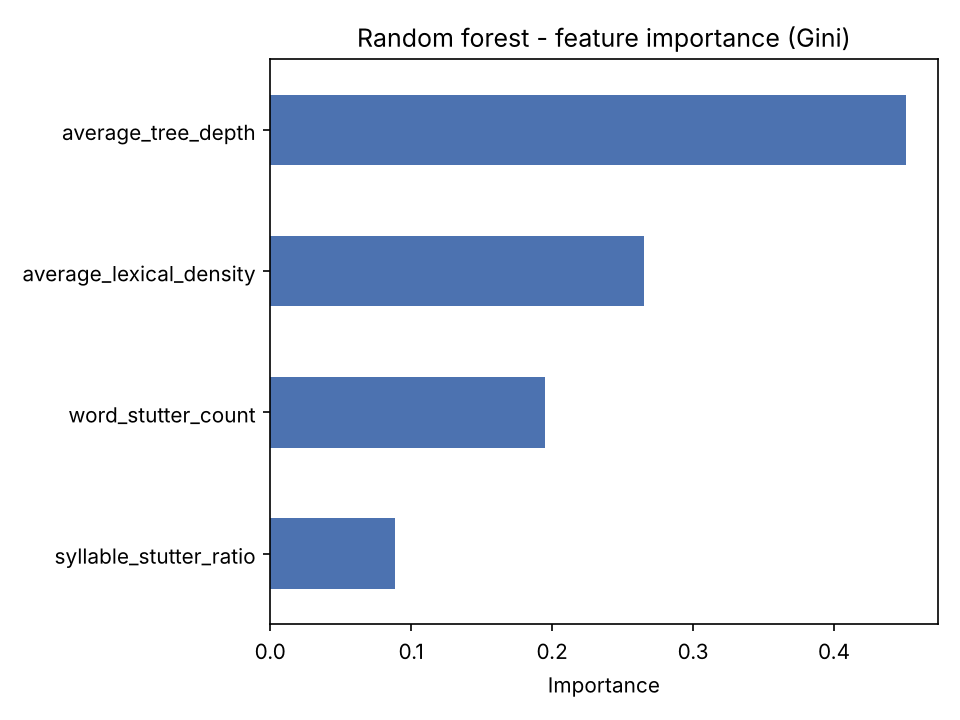
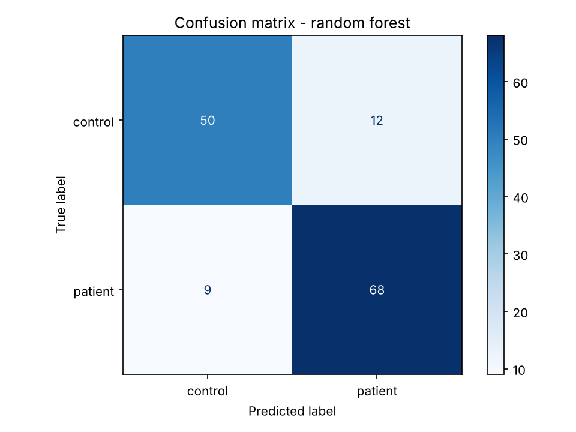
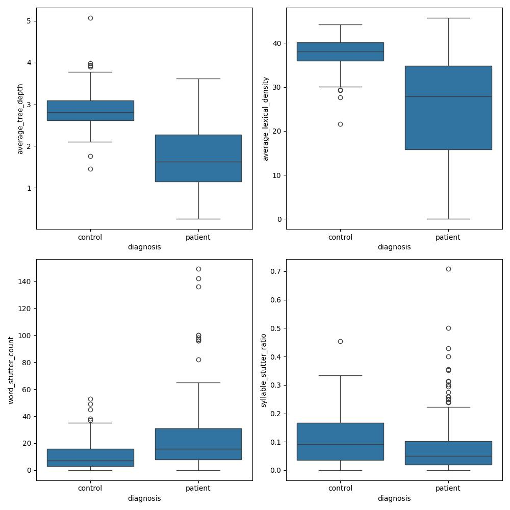

# CarePhasia — Multilevel linguistic analysis of aphasic speech

> Interpretable machine-learning prototype that flags **aphasia-like linguistic patterns** in English speech transcripts, using syntactic, morphological and disfluency features.
> ⚠️ Research prototype — **not a diagnostic tool**.

  

## Overview

Aphasia is a language disorder, usually caused by a stroke, whose severity and error types vary widely between patients. CarePhasia explores whether a small set of **linguistically motivated, explainable features** can separate aphasic from non-aphasic discourse, while telling the user *why* a transcript looks aphasic.

```
transcript.txt ─► sentence segmentation (spaCy)
                    ├─► syntax      : dependency-tree depth
                    ├─► morphology  : function-word ratio ("lexical density")
                    └─► disfluency  : word repetitions, syllable repetitions
                                   │
                                   ▼
                     Random Forest ─► probability + per-feature explanation
```

## Results

Dataset: **463 English transcripts** from AphasiaBank (289 aphasic, 174 control). Same 70/30 split as in the original study (139 test transcripts), plus a 5-fold stratified cross-validation added in this version.

| Model | Test accuracy | Test F1 (macro) | 5-fold CV F1 (macro) |
|---|---|---|---|
| Decision tree | 0.81 | 0.80 | 0.81 ± 0.05 |
| **Random forest (4 features)** | **0.85** | **0.85** | **0.86 ± 0.04** |
| Random forest on TF-IDF words only *(original study)* | 0.76 | 0.74 | — |

The four interpretable features beat a bag-of-words baseline. **Syntactic tree depth** is by far the most informative feature, in line with the *tree-pruning hypothesis* of agrammatism (Friedmann & Grodzinsky, 1997).

<p align="center">
  
  
</p>

Feature distributions per group:

<p align="center"></p>

`carephasia.analyze` returns a probability and one explanation line per feature, comparing the transcript with the control-group mean:

```
Probability of an aphasia-like linguistic pattern: <p>%
 - average_tree_depth = <value> (below the control mean 2.86) -> consistent with an aphasic pattern
 - ...
```

## Quick start

```bash
git clone https://github.com/AWARKEH1/carephasia.git
cd carephasia
python -m venv .venv && source .venv/bin/activate
pip install -r requirements.txt
python -m spacy download en_core_web_sm

python -m carephasia.train                                   # reproduces the table above
python -m carephasia.analyze examples/sample_transcript.txt  # analyses a new transcript
pytest                                                       # unit tests
```

## Project structure

```
carephasia/
├── carephasia/
│   ├── features.py   # tree depth, function-word ratio, stutter metrics
│   ├── train.py      # training, evaluation, cross-validation, figures
│   └── analyze.py    # CLI: transcript -> probability + explanation
├── data/             # per-transcript features (no raw text, see data/README.md)
├── examples/         # invented sample transcript
├── results/          # metrics.json and figures
└── tests/
```

## Method

| Level | Feature | Hypothesis |
|---|---|---|
| Syntax | Mean depth of the dependency tree | Aphasic speech uses shorter, flatter sentences |
| Morphology | % of function words (ADP, AUX, DET, PRON, CONJ, SCONJ) | Telegraphic speech drops function words |
| Disfluency | Sentences with an immediate word repetition | More repetitions in aphasic speech |
| Disfluency | Share of non-dictionary tokens with a repeated letter sequence | Captures syllable repetitions ("ba-ba-ball") |

Preprocessing (original study): `.cha` → JSON → CSV, interviewer turns removed, pragmatic markers (e.g. `&=laughs`) and symbols removed with regex. The original project also tested an LSTM sentiment model as a complementary indicator (not used for classification).

## Limitations

- Small dataset, English only, single corpus: results should not be generalised.
- Works on **transcripts**, not audio: an ASR front-end was explored but not kept.
- Disfluency features rely on a dictionary lookup; the original word list was not versioned and is replaced here by `wordfreq`, so recomputed values can differ slightly from the published ones.
- Not clinically validated. A diagnosis can only be made by a health professional.

## Credits

Team project of the Master **NLP – IDMC, Université de Lorraine** (2023–2024), by
Abbas Awarkeh, Alexandre Assmus, Alicia Sadler, Bassem Jaber, Belén Saavedra, Efua Yankson, Elise Soenen, Fairooz Azim and Marina Musse.

- Original group repository: [Belen96x/703-CarePhasia](https://github.com/Belen96x/703-CarePhasia)
- This repository is my refactored version: modular code, portable paths, CLI, unit tests, cross-validation and documentation.

Data: MacWhinney, B., Fromm, D., Forbes, M. & Holland, A. (2011). *AphasiaBank: Methods for studying discourse.* Aphasiology, 25(11).
